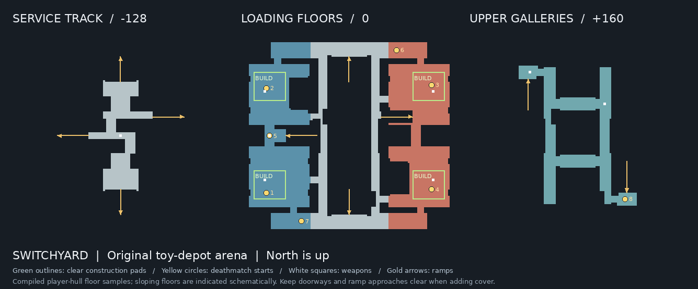

# Operation Switchyard

An original Plastic Platoon deathmatch arena built as a chunky toy freight
depot: blue loading halls on the west, red halls on the east, concrete floors,
wood roof frames, a recessed service track, and covered crossings above it.

Restart the game after installing the package. Use `map pp_switchyard` to keep
the current rules, `exec switchyard_dm.cfg` for 20-frag / 10-minute deathmatch,
or choose **Operation Switchyard** in the split-screen map selector. The launch
config retains the current player/controller setup and enables spawn farthest.

## Layout

The arena has three walking elevations: service track **−128**, dock floors
**0**, and galleries **160**. Six ramps connect them without requiring jumps.
The two overhead crossings, the north/south crossstreets and the offset side
approaches provide multiple circuits. A central dispatch house makes an S turn
in the lower track; enclosed dock walks and staggered gallery windows limit
views across the depot. Eight deathmatch starts
are spread around the map. An exploration start and three co-op starts also
allow loading the level outside deathmatch; there are no enemies or objectives.

Eight weapon locations distribute shotguns, rifles, an M60, a grenade launcher
and a rocket launcher around the different routes. The rocket launcher is in
the contested lower dispatch passage; body armor is in the red north hall.
There are 25 pickups in total. Architecture and lighting are static.

## Add your own blocks

The main loading floors are deliberately unfurnished. There are no crates,
ABC blocks, barricades, sandbags, freestanding cover props or moving machinery.
The existing beams, ramps and bridge supports are part of the architecture.
The following rectangles are independently checked as clear standing floor:

| Loading pad | X range | Y range | Floor Z |
| --- | --- | --- | --- |
| Blue north | −960 to −640 | 352 to 640 | 0 |
| Blue south | −960 to −640 | −640 to −352 | 0 |
| Red north | 640 to 960 | 352 to 640 | 0 |
| Red south | 640 to 960 | −640 to −352 | 0 |

These are guaranteed clear construction pads within larger open rooms; you can
use additional floor space while keeping the ramp entrances and routes open.
The standing player hull is 32 units wide. Keep a useful walking lane around
new cover, and recheck visibility/performance after furnishing.



The editable master is `maps/source/pp_switchyard.map`. Its installed editor
copy is `baseq2/maps/pp_switchyard.map`. Make your TrenchBroom edits to the master
and compile that exact file. **Regenerating the level overwrites manual edits.**

After adding cover, remove those pads from `open_build_areas` in
`tools/maps/switchyard_routes.json` (use an empty list if all four are furnished).
Update any route points that your new cover occupies. The build then checks the
remaining declared empty pads and your updated routes instead of rejecting the
blocks you intentionally added. Run the build and package commands below;
do not run the generator over your edited MAP or route document.

## Geometry and performance budget

Temple is the measured baseline, with a ceiling of **7/6 of its triangle budget**
(about 16.67% extra). The verifier checks compiled renderable triangles, all
compiled face-fan triangles and face counts separately. Temple's 1,014 original
reference triangles are not its compiled or rendered triangle count.

Visible geometry is checked in the actual GL1 engine using the same binary,
renderer, FOV and visibility options for both maps. Four-player checks rotate
through named floor positions and record per-view and whole-display counters.
Those are sampled workloads, not an exhaustive worst-case or a prediction of
FPS on another machine. The reported 35 FPS Temple result is the user's device
baseline; the new level still needs a test on that device. Furnishing adds to
the measured cost.

Full VIS, sealed solid room volumes, small architectural passages, static
lighting and conservative floor/ceiling texture scales keep unnecessary
subdivision and hidden submissions down. Existing original project materials
are used throughout; no commercial level data or new media is required.

The delivered build's matched four-player GL1 sweep uses 21 Switchyard floor
positions, eight yaw directions and visible first-person weapons. All four
players remain alive in all 49 captured states. The Temple comparison uses its
eight named architectural positions with the same client, renderer, game,
art archives and settings. Camera coverage differs between the two layouts.
Each row below is its own sampled maximum; the maxima need not share a frame.

| Submitted workload | Temple | Switchyard | Change |
| --- | ---: | ---: | ---: |
| Scene triangles per view, world + models | 12,908 | 13,511 | +4.67% |
| Scene triangles per four-view display | 24,474 | 24,605 | +0.54% |
| Draw calls per four-view display | 138 | 131 | −5.07% |
| Brush triangles per four-view display | 2,209 | 2,663 | +20.55% |
| Compiled renderable brush triangles | 9,800 | 4,456 | −54.53% |

The overall scene target is met. The brush-only display component exceeds its
separate 16.67% advisory reference by 86 triangles. Draw submission is lower,
and overall scene cost remains within target. Detailed evidence is in `build/switchyard/final-budget.json`
and `build/switchyard-qa/switchyard-final-armed/run.json`.

## Rebuild and verify

```sh
# Only for restoring the generated layout; overwrites the editable MAP.
python3 tools/maps/generate_switchyard.py

# Also works directly on a manually edited master.
python3 tools/maps/build_switchyard.py --threads 4
python3 tools/maps/package_switchyard.py
```

The build prepares private color-correct compiler textures and runs BSP, full
VIS and RAD. The independent verifier checks all 30 walking connections in
both directions, floor support, connected spawns, pickups, clear building pads,
materials and geometry budgets. Packaging requires matching verified MAP/BSP
hashes and installs `operation-switchyard.pk3` into `baseq2` and `release/baseq2`.
Restart after replacing the archive; PK3 maps override loose BSPs.

```sh
python3 tools/maps/capture_sandkeep.py --map-name pp_switchyard \
  --map baseq2/maps/pp_switchyard.bsp --materials baseq2 \
  --views tools/maps/switchyard_views.json --output-root build/switchyard-qa \
  --label my-architecture --renderer gl1
python3 tools/maps/check_switchyard_runtime.py --players 4 --label my-sweep
python3 tools/assets/smoke_standalone.py --map pp_switchyard \
  --renderer gl1 --renderer gl3 --frames 30 --output-dir build/switchyard-smoke
```

Choose fresh output labels. Captures and client tests run in disposable game
directories, preserving settings and saves. They use teleportation for repeatable
camera sampling and do not replace a manual match. Verification and package
records live under `build/maps/pp_switchyard`.
