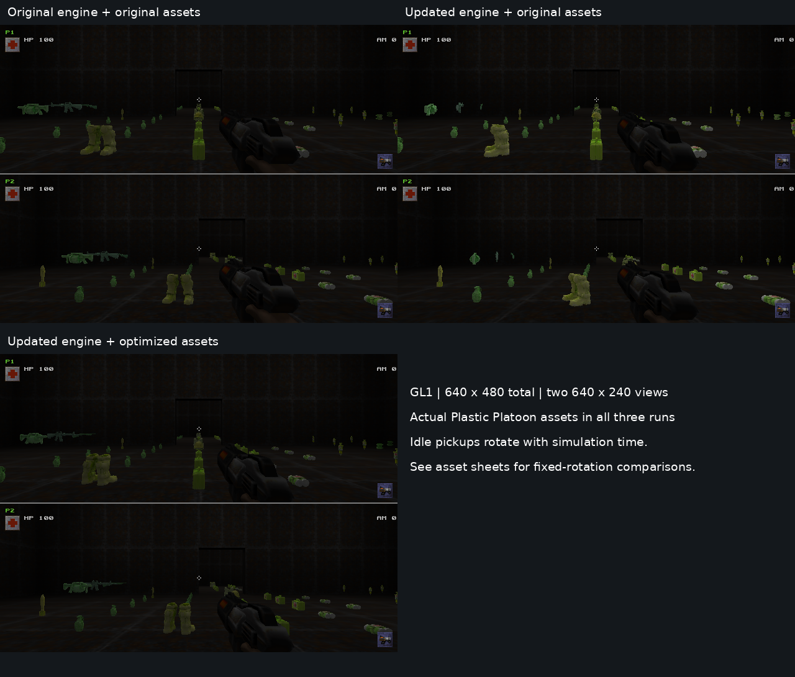

# Plastic Platoon performance implementation and validation

This branch makes split-screen effect processing independent of camera count,
retains static world/model resources in both fixed-function and shader renderers,
optimizes 16 static pickup assets, and adds complete-display-frame diagnostics,
reproducible asset packaging and release map compilation.

The measured host result is substantial, but **Pi Zero 2 W performance remains
unverified**. On a controlled llvmpipe software-rendered pickup fixture, GL1
median complete-frame time fell by 13.8–20.3% with the original assets, and by
53.8–58.9% with the optimized assets as well. The actual sandbox's distributed
BSP, original compile logs, custom texture set, three linked soldier weapon
models and Pi/Game Bird hardware were not available. Diagnostic sandbox
compilation and wave checks are qualified separately below.

## Three separate categories

| Category | Implemented work | Evidence and practical limit |
| --- | --- | --- |
| Engine efficiency at equivalent content/settings | Shared occurrence routing and effect preparation; persistent world and MD2 resources; equivalent-input pose cache; reusable PVS stamp sets | Production-function regression fixtures, real GL1/GL3 captures with original assets, renderer lifecycle checks |
| Asset optimization with visual review | Sixteen static MD2s; thirteen 2048² pickup skins reduced to 256²; separate machinegun pickup skin | Pinned source hashes, reproducible conversion, production loader validation, four-angle comparison sheets and actual-game screenshots |
| Explicit low-end tradeoffs | The Pi preset requests 240×240 with shadows/MSAA/anisotropy off; optional `pi_zero2_low.cfg` additionally selects picmip 1 and disables dynamic lightmap updates | Separate opt-in profiles; the timing tables keep every compared revision at the same stated settings |

No population cap, deferred spawning, lower simulation rate, replacement local
network protocol, hidden entities or disabled particles was used to obtain the
quiet-scene gains. One authoritative server simulation, one frame begin/present,
two half-screen views and existing PVS/area/frustum/backface rejection remain.

## Measured host results

### Environment and comparison method

Baseline source was the actual repository HEAD at the start of work:
`f2d9366ec7d2bbd256b5d103f1a57c6a5e1b011b`. It matched the earlier audit.
The baseline was built in a separate detached worktree with diagnostic-only
timing hooks. Both revisions used the Makefile release configuration, GCC 13.3
and confirmed `-O2`, `-fomit-frame-pointer`, `-fno-strict-aliasing` and `-fwrapv`.

The machine was an x86-64 AMD EPYC 9V74 VM with nine available CPU threads,
Ubuntu 24.04.3, Linux 6.18.57 and Mesa 25.2.8 llvmpipe/LLVM 20.1.2. There was no
`/dev/dri` device. Xvfb provided the display and `LP_NUM_THREADS=2` fixed the
software renderer worker setting. These are software-host results, not physical
GPU or Pi measurements.

The synthetic two-room fixture has full VIS, baked lighting and 92 pickup
placements matching the targeted asset inventory. Total framebuffer size was
640×480 for every run; split views were each 640×240. The runner fixed VSync off,
picmip 0, dynamic lighting on, all entities/lights/particles on, no shadows/MSAA/
anisotropy, and identical texture filtering. Sound initialization was off.
Actual cameras and submitted entity counts matched between corresponding runs.
All timing jobs ran serially without competing builds. Each capture has 600
complete frames, with 120 warmup rows discarded, leaving 480 timed frames.

The three versions are:

- **Baseline:** original engine plus original project assets.
- **Engine:** optimized engine plus original project assets.
- **Assets:** optimized engine plus optimized project assets.

The new renderer's richer counters and optional asynchronous GPU queries add
diagnostic overhead not present in the baseline renderer. That overhead was not
subtracted. Each scenario is one descriptive host pass, not a repeated-trial
confidence interval. The isolated fixture establishes a repeatable pickup-heavy
workload; it does not establish the whole sandbox's frame rate.

### Complete display-frame distributions

| Backend / scenario | Version | Median ms | P95 ms | P99 ms | Frames >33.333 ms | Median process RSS MiB |
| --- | --- | ---: | ---: | ---: | ---: | ---: |
| GL1 / one player | Baseline | 23.610 | 31.126 | 36.744 | 3.5% | 414.7 |
| GL1 / one player | Engine | 18.815 | 33.509 | 36.021 | 5.4% | 416.3 |
| GL1 / one player | Assets | 10.918 | 17.328 | 22.315 | 0.2% | 146.7 |
| GL1 / nearby players | Baseline | 37.048 | 46.637 | 53.791 | 100.0% | 443.2 |
| GL1 / nearby players | Engine | 29.926 | 36.138 | 37.702 | 16.0% | 445.1 |
| GL1 / nearby players | Assets | 17.071 | 21.125 | 22.435 | 0.0% | 161.8 |
| GL1 / different areas | Baseline | 37.084 | 44.332 | 54.197 | 99.8% | 445.1 |
| GL1 / different areas | Engine | 31.971 | 37.335 | 43.278 | 23.8% | 446.7 |
| GL1 / different areas | Assets | 15.224 | 21.785 | 23.549 | 0.2% | 163.5 |
| GL3 / nearby players | Baseline | 57.876 | 81.873 | 107.658 | 100.0% | 417.8 |
| GL3 / nearby players | Engine | 50.477 | 78.098 | 101.662 | 100.0% | 420.0 |
| GL3 / nearby players | Assets | 30.276 | 49.256 | 53.547 | 22.5% | 166.2 |

The engine-only GL1 single-player P95 did not improve in this pass despite its
lower median. This is a reason to retain distributions and repeat on hardware.
The GL3 optimized-content P95 also exceeds the 30 FPS target on this software
implementation. No claim of universally stable 30 FPS follows from these results.

For nearby two-player GL1, median CPU renderer-call time fell from 33.316 ms to
24.535 ms with original content, then 12.591 ms with optimized content. Shared
server-frame work was about 0.027 ms median in that quiet scene. Rendering and
driver work, rather than the shared simulation, dominated this fixture. Local
snapshot/send timing is instrumented; the networking path was retained.

CPU submission includes possible driver blocking. SDL presentation can include
unfinished rendering and swap/copy work. The optional GL3 driver query samples
had median per-view times 24.176 ms with original assets and 14.233 ms with optimized
assets. They are delayed, deduplicated software-driver samples, not whole-frame
GPU times and not Pi execution measurements. No glFinish was added.

Raw compressed CSVs, settings, commands, logs, hashes, complete distributions
and actual cameras are in [the capture manifest](results/host-2026-10-31/quiet/manifest.json)
and [environment record](results/host-2026-10-31/quiet/environment.json).
[The benchmark procedure](benchmarks.md) includes exact commands, baseline
instrumentation and interpretation rules. Early runs that accidentally used
stock PAK models were excluded; the measured runs loaded the correct project
PK3 archive, verified by startup logs and the model-triangle counters.

### Steady-state workload evidence

These measured counters are per complete display frame for the nearby two-player
fixture, after warmup. Both columns use the optimized engine; only assets differ.

| Counter | Original assets | Optimized assets |
| --- | ---: | ---: |
| Submitted model triangles, GL1 and GL3 | 364,508 | 129,360 |
| Submitted world triangles | 650 | 650 |
| GL1 draw calls | 169 | 169 |
| GL3 draw calls | 425 | 425 |
| GL1 instrumented client vertex payload | 1,494,776 bytes | 672,880 bytes |
| GL3 dynamic vertex upload payload | 5,964,488 bytes | 2,676,904 bytes |
| GL3 dynamic index uploads | 0 | 0 |
| Static vertex/index uploads during warm frames | 0 | 0 |
| MD2 topology rebuilds | 0 | 0 |
| PVS rebuilds / cache hits | 0 / 2 | 0 / 2 |

Static resource creation is paid at registration and reported separately. Model
lighting colors still vary per instance, so dynamic vertex traffic is not zero.
GL1 client payload is not a driver-DMA measurement. The unchanged draw counts
demonstrate that mesh simplification and persistent data reduced work without
hiding entities or collapsing the world into one always-visible batch.

The original engine did not publish these detailed counters. A separate exact
code/asset accounting example in [renderer.md](renderer.md) shows the unchanged
2,000-triangle shard's GL1 per-instance position/UV/color/index payload falling
from 107,568 bytes to 8,428 bytes of instance colors, and GL3 buffer payload from
155,352 bytes to 33,712 bytes. This is workload accounting, not measured FPS.

## Correct shared effects

Shared native temporary events are routed once at the authoritative multicast
occurrence, after ordinary visibility/area eligibility. An eligible secondary
still receives a secondary-only event. Two identical multicast calls in the same
tick remain two occurrences. No payload hash or display-frame identity is used,
so delayed parsing and session/map resets cannot accidentally erase new events.
Remote recipients, unicast feedback and wire formats are preserved.

Particles, trails, sustains and shared sprites are prepared once before camera
submission. Instant particles stay available to both views. Equivalent entity
inputs can reuse work; differing histories/interpolation and disjoint entity sets
retain separate representations and view masks. Per-camera weapons, prediction,
scoped flashes, beam alignment and lighting remain per view.

| Production-function regression | Observed result |
| --- | --- |
| One rocket explosion delivered to both local players | One parse, 296 particles, one sound |
| Explosion visible only to player two | One parse, 296 particles retained |
| Two identical occurrences in one tick | Two parses, 592 particles |
| Next-tick identical occurrence parsed 37 display frames later | Third occurrence retained |
| One normal plus one instant particle | Both views submit two; reverse order unchanged |
| Shared projectile with equivalent one/two-view inputs | Eleven particles in either case; one evaluation plus one reuse for two views |
| Different interpolation inputs / disjoint snapshots | Correct scoped representations and full entity union |
| Additional view submission | No shared particle update, expiry, trail mutation or PRNG consumption |
| Pause/resume, irregular cadence, reliable loading/reconnect and buffer overflow | Focused assertions pass |
| Different-map transition while two local clients are active | Both clients rejoin with matching map generations in GL1, GL3 and GLES1 |

[Shared-effects documentation](shared-effects.md) describes the actual fixture,
protocol limits, reliable/unreliable semantics and complete regression matrix.
Custom game modules that mix temp events with other service commands in one
multicast retain ordinary delivery; native Plastic Platoon events are separate.

Live testing also uncovered a pre-existing secondary-client map-transition bug.
Player two ignored the server's `changing` and `reconnect` commands and could
render an old snapshot against a newly registered model table. The baseline
engine with original assets reproduced a stalled different-map transition.
Secondary clients now complete the handshake, clear stale snapshot/history
state and wait for a valid snapshot matching the primary map generation. The
fixed engine passed actual fixture-to-`demo1` transitions in GL1, GL3 and GLES1.
Local profiles and physically held input remain intact. This fix addresses a
correctness defect found during validation; its benefit is not included in the
steady-scene timing percentages.

## Models, textures and visual identity

The 16 targeted static models total 36,064 → 13,094 triangles. Weighted by 92 initial
sandbox placements, they total 211,975 → 74,769 triangles, a 64.7% reduction before
culling. Position vertices fall 105,586→36,995 and UV-expanded render vertices
215,079→96,254 across those placements. MD2 file bytes total 1,650,089→574,500.

The unique pickup-skin RGBA base-level estimate falls 208.75 MiB → 4 MiB. The original
machinegun skin remains available to the animated soldier weapon; with that
shared actor texture loaded, the comparable combined set is 208.75 MiB → 20 MiB.
These estimates exclude other textures, mipmaps and driver overhead. Process
RSS measurements above are a different quantity and cannot predict Pi memory.

The accepted models use 500–1,000 triangles. More aggressive 350–400 triangle trials
damaged straps, medkit crosses, rounded bandages and grenade pins, so the default
assets deliberately exceed some provisional Pi budgets. Animated actors and
first-person weapon meshes are unchanged. A separate animated retopology pass
would be needed to lower their cost safely.

[The asset report](assets.md) provides every model's triangles, position/render
vertices, frames, dimensions, byte sizes, memory estimates, bounds and review
findings. [The manifest](assets-manifest.json) pins source/output hashes, tool
versions and conversion settings. Sixteen sheets compare four rotations at 48 px
gameplay coverage and 224 px inspection coverage. Visible close-up faceting and
small UV changes are documented. Original sources remain recoverable from the
pinned baseline commit.

The runtime screenshots use the same actual cameras and settings; idle pickup
rotations differ with elapsed simulation time. Use the fixed-rotation asset
sheets for precise silhouette comparison. Engine-only rendering retained the
original geometry, UV seams, transforms and appearance in these inspections.

## Map, sustained gameplay and hardware validation

The exact supplied source inventory is preserved in
[sandbox-source.json](sandbox-source.json): 1,738 brushes, 1,664 world brushes,
499 detail brushes, 11,317 source faces, 155 pickups, 37 initial monsters, 26 spawners,
13 timers and 118 placed lights. Of 1,201 primarily sand brushes,1,144 are structural;
the latter includes 17 brush-entity brushes. Worldspawn alone has 1,127 structural
sand brushes and 57 detail sand brushes.

A fresh compile of the original source produced 8,259 nodes, 8,311 leaves,
12,523 faces and 1,321 visibility clusters. Full VIS completed and produced
400,024 bytes of valid visibility data. A separate RAD pass also completed,
producing 1,043,373 lighting bytes and passing the BSP/PVS/lighting validation.
All 13 custom texture paths were still missing, so default compiler reflectivity
was used and this remains a diagnostic BSP. Mean visible clusters were 450.587 of 1,321
(34.11%), versus 1,143.191(86.54%) for diagnostic fast VIS. This establishes the
value of full VIS for this source. It says nothing about the unavailable original
distributed BSP's compile settings. The full-VIS wall-clock log includes a
deliberate pause during timing comparisons and is not a compile-speed benchmark.

Release tooling now defaults to BSP + full VIS + baked lighting, records logs and
hashes, validates BSP/PVS structure, rejects leaks/missing textures and preserves
an older published BSP after failure. The supplied map is unchanged. Four
contained sand-brush conversions produced no useful BSP change; twenty interior
ladder-brush conversions gave small structural reductions without demonstrated
visibility gains. [Terrain review](terrain-review.md) records the conservative
experiments and source-derived wave/corpse lifetime findings.

Sustained diagnostic results are recorded in [sustained validation](sustained.md).
They separate the native effects fixture from the real sandbox's wave logic,
and identify missing textures/attachments, unlit or diagnostic visibility data,
concurrent functional work and other limitations. They are not substituted for
an equivalent-quality sandbox timing comparison.

The host's packaged Mesa lacked GLES1. An isolated GLES1-enabled Mesa build was
used to exercise the actual GLES1 renderer at 240×240 using softpipe. This verifies
the fixed-function API path on a host implementation; it does not verify VC4.
[Renderer details](renderer.md) and [lifecycle checks](lifecycle-validation.md)
record actual backend identity, viewport sizes, fallback/resource behavior and
remaining limitations.

The final GL1/GL3 lifecycle runs each completed five 120-frame phases with both
local players confirmed spawned after every transition. Every complete display
was 240×240 with two 240×120 views. GLES1 additionally passed a 346-frame,
692-view fixture-to-`demo1`-to-fixture round trip and renderer restart. Renderer
view identities remain monotonic across reloads, and unsupported GLES GPU timing
is reported as unavailable. These are functional host checks, not Pi timings.

## Build and test evidence

- Optimized client, dedicated server, game module, GL1, GLES1, GL3, GLES3 and
  software renderer builds are supported by the unchanged build families.
- Production effect fixtures pass optimized and AddressSanitizer/UndefinedBehaviorSanitizer
  runs. Leak inspection was disabled only for that fixture's restricted-process
  environment and is not claimed for it.
- Production MD2/cache/visibility/texture fixtures pass ordinary and sanitizer
  runs, including all 16 optimized models,16 original models and 104 animated/static
  compatibility models from the official demo. Renderer fixture leak checking
  passed in the permitted normal executor.
- Eight asset-pipeline tests validate format, frames, winding/normals, seams,
  deterministic regeneration, corrupt-input rejection and unchanged actor data.
- Eighteen map-tool tests validate real wrapper subprocess invocation, full
  release stages, paths with spaces, failures/leaks/missing assets, publication
  preservation and malformed BSP/PVS rejection.
- Sixteen benchmark/package tests validate argument safety, capture preservation,
  metadata, delayed GPU origins, deterministic project-only packaging and exact
  archive provenance.

Commands and source-linked details are in the individual documents. The test
fixtures prove the assertions they execute; live screenshots, captures and
hardware tests establish different kinds of evidence.
The [preserved binary hashes](results/build/preserved-binary-hashes.json),
[verified compiler commands](results/build/verified-compiler-commands.txt),
[release build log](results/build/release-build.log), and
[final client rebuild log](results/build/map-transition-client-build.log)
retain the build provenance. The final client hash matches the executable used
for the successful different-map and lifecycle checks. A later environment
recycle removed installed development packages; an ensuing no-op Make invocation
is not counted as another compilation.

## Remaining work with the highest value

1. Run the supplied commands on the actual Pi with hardware VC4 acceleration,
   complete custom assets and a release-compiled sandbox. Measure complete
   frames, system/process memory, thermals, slow frames and ten-minute behavior.
2. Measure Game Bird 240×240 transfer separately from scene submission and SDL
   presentation; compare the identical scene over HDMI. No transfer frontend
   was available here.
3. Profile GL1 dynamic-light marking/lightmap rebuilds during real combat. This
   branch retains per-view light sets rather than assuming they are equivalent.
   Share only verified matching inputs if that work dominates.
4. Reduce GL3 draw submission and per-instance color uploads while retaining
   useful PVS/material granularity. Its persistent world path still draws
   visible surfaces individually. Do not replace culling with one global batch.
5. Evaluate animated soldier and linked weapon assets at their real screen
   coverage. The default static asset reductions are conservative; further
   topology work should follow device measurements and animation review.
6. Investigate any long-session corpse/projectile accumulation with the new
   counters and actual gameplay. Keep changes to wave completion, populations
   or effect budgets explicit and separate from equivalent-quality gains.

[Pi build, launch, preset and measurement instructions](pi-zero2.md) provide the
next device procedure. The 30 FPS target is an investigation target, not a result
claimed for unavailable hardware.
