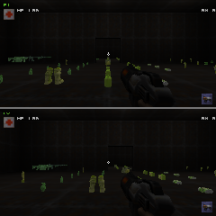

# GLES1 software-host functional validation

This is an API, rendering and resource-lifetime check. It is not a Raspberry Pi
benchmark and does not establish hardware-accelerated performance.

## Why the installed driver could not create a context

The host uses Ubuntu's Mesa `25.2.8-0ubuntu0.24.04.2`. Its exact
[source package](https://snapshot.ubuntu.com/ubuntu/20260828T000000Z/pool/main/m/mesa/mesa_25.2.8-0ubuntu0.24.04.2.debian.tar.xz)
sets `confflags_GLES = -Dgles1=disabled -Dgles2=enabled` in `debian/rules`.
The installed `libGLESv1_CM` dispatch library therefore did not provide working
Mesa GLES1 contexts. A standalone SDL context probe and a direct EGL probe both
failed for ES1 with `EGL_BAD_ALLOC`; the direct EGL probe created ES2/ES3
contexts successfully.

Changing the SDL accelerated-visual request among 1, 0 and -1, requesting ES1.0
or ES1.1, reducing depth/stencil requirements, and switching between Xvfb and
SDL's offscreen video driver did not repair the failure. The engine's existing
context attributes and acceleration defaults were retained.

## Isolated driver build

An upstream Mesa 25.2.8 build with GLES1 enabled and the CPU `softpipe` driver
provided the missing API. It was installed only under a temporary prefix;
system graphics libraries were not replaced.

Source:

```text
https://archive.mesa3d.org/mesa-25.2.8.tar.xz
SHA256 097842f3e49d996868b38688db87b006f7d4541e93ce86d2f341d8b3e7be7c93
```

Recorded tools: GCC 13.3.0, Meson 1.12.1, Ninja 1.11.1, Bison 3.8.2,
Flex 2.6.4, Python 3.12, Mako 1.4.3, SDL 2.30.0. Development dependencies
included zlib, zstd, expat, libdrm and libudev. LLVM was not needed.

Example configuration after extracting the source:

```sh
mesa_root=/tmp/pp-gles1-mesa
python3 -m venv "$mesa_root/venv"
"$mesa_root/venv/bin/pip" install meson==1.12.1 mako==1.4.3 packaging==26.3 PyYAML==6.0.3
PATH="$mesa_root/venv/bin:$PATH" meson setup \
  "$mesa_root/build" "$mesa_root/mesa-25.2.8" \
  --prefix="$mesa_root/install" --libdir=lib --buildtype=release \
  -Dgallium-drivers=softpipe -Dvulkan-drivers=[] -Dllvm=disabled \
  -Dgles1=enabled -Dgles2=disabled -Dopengl=false \
  -Dplatforms=[] -Degl-native-platform=surfaceless \
  -Degl=enabled -Dgbm=disabled -Dglx=disabled -Dglvnd=disabled \
  -Dgallium-vdpau=disabled -Dgallium-va=disabled \
  -Dvideo-codecs=[] -Dbuild-tests=false
ninja -C "$mesa_root/build" -j8
"$mesa_root/venv/bin/meson" install -C "$mesa_root/build" --no-rebuild
```

The unchanged SDL request then created a context reporting:

```text
SDL video driver: offscreen
GL_VENDOR: Mesa
GL_RENDERER: softpipe
GL_VERSION: OpenGL ES-CM 1.1 Mesa 25.2.8
```

## Actual engine check

The runtime contained the current project asset PK3, optimized loose models,
the diagnostic `pp_perf_fixture.bsp`, and the locally available Quake II demo
data for remaining base assets. Some optional weapon/sound files absent from
the project remain missing; the engine logged those misses. This check uses
the diagnostic pickup fixture, not the sandbox map.

With an isolated runtime already prepared, run as an ordinary user:

```sh
mesa_root=/tmp/pp-gles1-mesa
runtime=/path/to/isolated-runtime
env LD_LIBRARY_PATH="$mesa_root/install/lib" \
  LIBGL_DRIVERS_PATH="$mesa_root/install/lib/dri" \
  SDL_VIDEODRIVER=offscreen LIBGL_ALWAYS_SOFTWARE=1 \
  GALLIUM_DRIVER=softpipe MESA_SHADER_CACHE_DISABLE=true \
  python3 tools/performance/run_benchmark.py \
    --binary "$runtime/quake2" --data "$runtime" \
    --label gles1-functional-240 --renderer gles1 \
    --map pp_perf_fixture --players 2 --size 240x240 \
    --frames 180 --warmup 30 --timeout 120 --screenshot
```

For the root-owned CI executor used here, the runner additionally used
`--unprivileged nobody` and a runtime writable by that account. This is not
needed when launching as a normal user.

The actual engine completed the 180-frame capture. Every retained frame after
30 warm-up frames contained two 240×120 views in the same 240×240 framebuffer.
The warm views reported zero topology rebuilds, zero compressed-pose vertex
preparation for the stationary cached scene, and zero static vertex/index
uploads. The GPU timer capability correctly reported unavailable for GLES1.



The image was inspected for intact world geometry, pickup skins and silhouettes,
shadows, first-person weapons, and both viewports. Its low illumination follows
the diagnostic map/settings. CPU frame times from this software-only run must
not be compared with the separate llvmpipe GL1/GL3 performance captures, and
must not be presented as a Pi result.

## Resource lifecycle result

A second actual-engine capture completed **348 display frames and 696 views**
at the same 240×240 framebuffer resolution. It switched `gl1_static_world`
off and on, ran `vid_restart`, loaded a differently named byte-identical BSP
through a queued `gamemap`, and loaded the original fixture again. Four
screenshots were inspected. World geometry, models, skins, shadows and weapons
remained intact. Renderer serials increased strictly from 1 through 696 across
the restart, and every GLES view continued to report unavailable GPU timing.

For stable frames with the same 650 submitted world triangles across both views,
the instrumented client vertex-array payload was 705,976 bytes with legacy world
submission and 672,880 bytes with persistent world buffers. It returned to
672,880 after restart and map reload. The measured difference is **33,096 bytes
of repeated client vertex-array payload per display frame** in this fixture;
it is not a DMA or frame-time measurement. Static vertex/index uploads were zero
in the sampled warm views. This comparison keeps content and rendering quality
unchanged.

The [packaged evidence](results/lifecycle/gles1/README.md) contains compressed
CSV captures, configuration, context probes, console logs and screenshots. Its
[result manifest](results/lifecycle/gles1/run.json) records binary/content hashes,
and its [archive manifest](results/lifecycle/gles1/archive-manifest.json) records
source/packaged hashes and redactions. The selected evidence is stored in this
repository; no temporary runtime, driver library, demo PAK or BSP binary is
required to inspect it.

A transition to the different `demo1` level initially exposed a separate stall
after client entry. The same transition stalled with the baseline GL1 engine
and original assets. Secondary clients ignored `changing`/`reconnect` commands
and could render old snapshots against the new map's model table. The client
fix now resets generation-dependent history, performs the reconnect handshake,
and accepts secondary presentation only after a valid snapshot for the current
generation. Physical held controls remain intact.

Repeating the previously failing GLES1 scenario after that fix completed
**346 display frames and 692 views**, with two views in every captured frame.
The sequence was pickup fixture → `demo1` → pickup fixture, including the same
static-world toggle and renderer restart. Both cameras had the correct new
map positions and entity sets, then returned to the fixture. View serials
increased strictly from 1 through 692 across restart and both map transitions.
The final screenshot was inspected. This establishes successful cross-map
rendering for the tested sequence in addition to the cloned-map cleanup check.
The [final command events](results/lifecycle/gles1/perf/gles1-lifecycle-fixed-240-events.json),
[per-view capture](results/lifecycle/gles1/perf/gles1-lifecycle-fixed-240-views.csv.gz),
and [returned-map screenshot](results/lifecycle/gles1/screenshots/different-map-return.png)
provide the corresponding evidence.

The renderer diagnostics also have an executable context-lifecycle fixture:

```sh
python3 tests/run_renderer_tests.py
python3 tests/run_renderer_tests.py --sanitize
```

It checks exact serial persistence above 2^32, simulated renderer DSO reload,
delayed asynchronous query origins, cleanup, and clearing desktop GPU results
when the next context has diagnostics disabled. See [renderer.md](renderer.md)
for counter definitions and the broader production-model validation.
