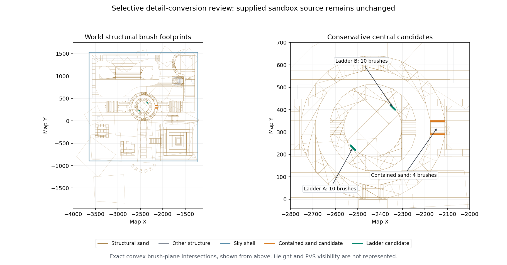

# Sandbox terrain and sustained-gameplay review

The supplied sandbox source remains unchanged. A conservative terrain experiment found a small reduction in BSP fragmentation from making two interior ladders detail geometry. It did not establish a meaningful frame-time improvement, and the missing texture set prevents a release-quality visual or lighting review. Broadly converting the sand terrain to detail is not justified by this inspection.

The exact source is [pp_sandbox_coop1.map](../../maps/source/pp_sandbox_coop1.map), SHA-256 `09dd444a8523b669d31c26940dd630f2ce42e7799ee6745a0622ccf5284bd550`. All experiment files were made separately under `build/map-experiments`; no experiment BSP was published as a release map.

## Structural geometry evidence

The source contains 1,738 brushes, of which 1,664 belong to worldspawn, and 11,317 brush faces. The 499 explicitly detail brushes include 477 world brushes. There are 1,201 brushes whose most frequent face texture is sand: 1,144 structural and 57 detail. The important distinction is that **only 1,127 of those structural sand brushes belong to worldspawn**. The other 17 belong to brush entities and do not partition world visibility like structural world geometry.

All 1,738 convex brush hulls were reconstructed from their face planes. Among structural world sand brushes, 435 fit within a 64-unit cube, 673 within a 128-unit cube, and 178 are no more than 16 units tall. Size alone is not a safe detail criterion: small adjacent brush segments form curved walls, the bottom seal, and useful occluders.



The figure shows exact reconstructed brush footprints. It does not represent height relationships, rendered surfaces or PVS visibility.

Four world sand brushes are entirely contained in untouched structural sand brushes. Their coplanar faces also have matching texture transforms. Containment was checked against every containing brush plane with a 0.0001-unit tolerance; the minimum clearance is zero at shared planes.

| Candidate world brush | Untouched containing brush | Candidate bounds, minimum to maximum |
|---:|---:|---|
| 1215 | 1221 | `(-2176, 348, -912)` to `(-2112, 352, -896)` |
| 1216 | 1222 | `(-2176, 346.667, -899.2)` to `(-2112, 348.8, -896)` |
| 1217 | 1227 | `(-2176, 288, -904)` to `(-2112, 293.333, -896)` |
| 1228 | 1218 | `(-2176, 288, -912)` to `(-2112, 291.2, -899.2)` |

Their conversion cannot remove a portion of the structural solid union because the containing brushes remain. Five other contained candidates were excluded because their coplanar texture offsets differed, making texture-priority changes harder to rule out. The compiler already eliminates the four accepted candidates' redundant structural contribution, so their conversion has no measured BSP benefit.

World brushes 502–511 and 517–526 form two interior ladders. Each ladder has two 6×6×140-unit rails and eight thin rungs. The complete groups occupy `(-2534,217,-704)` to `(-2508,243,-564)` and `(-2356,397,-576)` to `(-2330,423,-436)`. They are small interior structures away from the enclosing shell. Keeping their solid contents while adding detail preserves their source geometry; the resulting experimental BSPs also pass the compiler's leak check. Collision and visual behavior still require an actual game comparison before adopting a source change.

## Diagnostic compiler comparisons

The trials used q2tools-220 commit `07d8d893cb04ba5f39a63d7382e8d9979b3f38da`, one compiler thread, identical compiler options, and the original source or an exact copy with only the selected detail flags changed. The VIS stage used **`-fast`**, not full portal-flow visibility. This is sufficient to compare BSP fragmentation and validate visibility row encoding, but it cannot establish final occlusion quality. Compiler wall times are not a performance comparison because other validation jobs were running concurrently.

| Measure | Original | Four contained sand brushes | Twenty ladder brushes | Both sets |
|---|---:|---:|---:|---:|
| Source brushes | 1,738 | 1,738 | 1,738 | 1,738 |
| BSP nodes | 8,259 | 8,259 | 8,203 | 8,203 |
| BSP leaves | 8,311 | 8,311 | 8,255 | 8,255 |
| BSP faces | 12,523 | 12,523 | 12,495 | 12,495 |
| BSP vertices | 15,712 | 15,712 | 15,681 | 15,681 |
| Portal clusters | 1,321 | 1,321 | 1,270 | 1,270 |
| Portals | 4,448 | 4,448 | 4,342 | 4,342 |
| Fast-VIS mean visible clusters | 1,143.19 | 1,143.19 | 1,112.28 | 1,112.28 |
| Fast-VIS mean visible fraction | 86.54% | 86.54% | 87.58% | 87.58% |
| Leak detected / `.lin` generated | No | No | No | No |

Ladder conversion reduces clusters by 3.86%, portals by 2.38%, nodes by 0.68%, and faces by 0.22%. Cluster identities change between builds, and the mean visible fraction increases. Fewer visible cluster numbers therefore do not demonstrate less submitted world geometry. A full-VIS comparison at fixed camera locations, followed by equivalent-content runtime measurements, is the acceptance gate for adopting this optional change. The existing source is retained because the demonstrated gain is small and the release assets are unavailable.

Full VIS was subsequently completed on the **unchanged supplied source**, independently of the terrain variants:

| Original geometry visibility | Fast VIS | Full VIS |
|---|---:|---:|
| Clusters | 1,321 | 1,321 |
| Visibility lump bytes | 446,040 | 400,024 |
| Mean visible clusters | 1,143.19 | 450.59 |
| Mean visible fraction | 86.54% | 34.11% |
| Maximum visible clusters | 1,302 | 1,155 |

The full-VIS BSP SHA-256 is `f3b6ed2d8dd4533f510c041fbce250fcefa4565702fee0cbc9a7e9d2602cd940`. All PVS and PHS rows decode correctly and are subsets of the matching fast-VIS rows. The leaf records are identical. The only non-VIS binary differences are node-plane numbering from parallel BSP construction; comparing each referenced plane confirms identical geometry. This establishes that the supplied source can produce useful full visibility data. It does **not** establish that an unavailable previously distributed BSP lacked VIS, or directly predict an FPS gain from the cluster ratio. The compiler's logged 2,311-second portal-flow interval includes a long intentional process pause during engine benchmarks, so it is not an active compile-time measurement.

[The experiment manifest](terrain-experiments.json) preserves the source and output hashes, compiler revision/hash, commands, inventories, and validation results. [The original-source full-VIS compile log](results/terrain/original-bsp-fullvis-rad-attempt.log), the eight comparison-stage logs, and [the completed diagnostic RAD log](results/terrain/original-fullvis-diagnostic-rad.log) are preserved under `results/terrain`. The full-VIS attempt's following RAD stage initially failed because the original asset directory lacked `pics/colormap.pcx`; the successful VIS output was preserved. A separate diagnostic RAD invocation with the exact colormap extracted from the available official demo PAK then succeeded. Custom map textures are still missing.

The completed diagnostic BSP contains 400,024 bytes of visibility data and 1,043,373 bytes of baked lighting; its total size is 3,551,012 bytes and SHA-256 is `5b431476f8688669e0374449f410b86840ae3aab8bfd78fc9fa1dc96fbdf50be`. Strict BSP validation accepts every PVS/PHS row and the required lighting lump. The source geometry and entity definitions remain unchanged. Default reflectivity and missing WAL metadata still prevent release publication. Neither this BSP nor the demo palette is committed as a game asset.

All builds reported the same missing texture paths: `sandbox/wood1`, `sandbox/wood2`, `sandbox/bluesky1`, `sandbox/sand1`, `sandbox/water1`, `sandbox/plastic1`, `sandbox/abc_block_a` through `sandbox/abc_block_f`, and `common/caulk`. The original BSP pass also reports repeated `split not on both sides` diagnostics. No compiler leak was detected. These are newly produced diagnostic logs; the original map author's BSP and compile logs were not supplied.

Missing WAL files matter beyond appearance. They can supply default surface flags, contents, light values and texture reflectivity. The experiment copies append the same explicit detail triplet used elsewhere in this source when a face has no existing contents triplet. That uses zero flags/value, matching the diagnostic compile with missing WAL metadata. **Recheck the actual WAL metadata before applying these edits to a release source.** Detail conversion also does not remove the source geometry that must be drawn.

All 118 placed `light` entities are unnamed and use style zero/default. They are baked-lighting inputs. Thirty source sky faces explicitly use `SURF_LIGHT | SURF_SKY` with light value 300; subdivision produces thousands of compiler light patches. The diagnostic RAD output's 5,543 direct-light records are baked compiler emitters, not runtime dynamic lights. This also helps explain why RAD is computationally expensive despite the moderate placed-light count.

### Reproduce the conservative copies

From the repository root, the following standard-library script creates the three experimental MAP files and verifies that the supplied source is unchanged. Brush numbers are the source's `// brush N` indices in worldspawn, not global entity indices.

```sh
python3 - <<'PY'
from pathlib import Path
import hashlib, re
src = Path('maps/source/pp_sandbox_coop1.map')
original = src.read_bytes()
assert hashlib.sha256(original).hexdigest() == '09dd444a8523b669d31c26940dd630f2ce42e7799ee6745a0622ccf5284bd550'
sand = [1215, 1216, 1217, 1228]
ladders = list(range(502, 512)) + list(range(517, 527))
variants = {'contained_sand_detail': sand,
            'interior_ladders_detail': ladders,
            'contained_and_ladders_detail': sand + ladders}
for name, selected in variants.items():
    lines = original.decode().splitlines(keepends=True)
    depth, entity, brush = 0, -1, -1
    for n, line in enumerate(lines):
        s = line.strip()
        if s.startswith('// brush ') and depth == 1:
            brush = int(s.split()[-1])
        elif s == '{':
            depth += 1
            if depth == 1:
                entity += 1
        elif s == '}':
            depth -= 1
        elif entity == 0 and depth == 2 and brush in selected and s.startswith('('):
            m = re.match(r'((?:\(\s*[^)]+\)\s*){3}\S+\s+)(.*)', line.rstrip('\r\n'))
            tail = m[2]
            tokens = list(re.finditer(r'\S+', tail))
            assert '[' not in tail
            if len(tokens) >= 8:
                t = tokens[5]
                tail = tail[:t.start()] + str(int(t[0]) | 0x08000000) + tail[t.end():]
            else:
                assert len(tokens) == 5
                tail = tail.rstrip() + ' 134217728 0 0'
            lines[n] = m[1] + tail + ('\n' if line.endswith('\n') else '')
    out = Path('build/map-experiments') / name / (name + '.map')
    out.parent.mkdir(parents=True, exist_ok=True)
    out.write_text(''.join(lines))
    print(name, hashlib.sha256(out.read_bytes()).hexdigest())
assert src.read_bytes() == original
PY
```

Expected variant SHA-256 hashes, in that order, are `be9310e5779216419337441a3563b18f92e31d2b831390d0bcc1c423cb6db9eb`, `c0776861e9b1016b8bd1ae5204a42fdd7aae16ba7139682bc60ad8124b79f180`, and `8381606140b4a02a7a31709e067bffc3f3f2b774246e4dd44324bfffee3ca419`.

For each copy, run the pinned compiler with `-bsp -threads 1 -moddir <asset-baseq2> -basedir <asset-baseq2> <copy.map>`, then `-vis -fast -threads 1 -moddir <asset-baseq2> -basedir <asset-baseq2> <copy.bsp>`. Preserve separate stdout/stderr logs and reject a nonzero exit or `.lin` file. Use `python3 tools/performance/map_inventory.py <copy.bsp>` to validate the BSP and visibility encoding. This manual fast-VIS procedure is an experiment; [the release compile tool](../../tools/performance/compile_map.py) deliberately requires full VIS and baked lighting for release builds.

## Wave activation and timer semantics

The source has 37 initially placed monsters: 26 `monster_soldier_ss` and 11 `monster_soldier_light`. Its 26 `target_spawner` entities create 12 `monster_soldier`, 9 `monster_soldier_ss`, and 5 `monster_soldier_light` per complete set of firings. No `trigger_counter`, `count`, or `killtarget` property exists in this source. Wave progression is driven by three `trigger_once` volumes, delayed relay chains and timer toggles; it is not conditioned on killing every monster.

| Area | Activation trigger bounds | Timer group | Repeating monster spawners |
|---|---|---|---:|
| 1 | `(-3568,-824,-1008)` to `(-3376,-656,-952)` | `endArea1`, 5 timers | 8 |
| 2 | `(-3264,448,-920)` to `(-3008,480,-792)` | `t43`, 3 timers | 10 |
| 3 | `(-1856,160,-920)` to `(-1600,192,-792)` | `t78`, 4 monster timers plus 1 door timer | 8 |

The primary `info_player_start` is `(-1696,160,-880)`, yaw 45°, overlapping Area 3's trigger. The first cooperative start is `(-3528,-688,-984)`, yaw 45°, inside Area 1's trigger. `SelectSpawnPoint` and `PutClientInServer` add ten units to the source Z coordinate. Normal `ClientThink` calls `G_TouchTriggers` even with zero movement, so an ordinary two-player cooperative launch should activate Areas 1 and 3 without a teleport or gameplay cheat. Confirm the actual run by the `Get Ready` message at approximately five seconds and `Wave 1` at approximately 25 seconds after activation. Area 2 requires its trigger to be touched separately.

This is a material comparison constraint: a fresh single-player launch activates Area 3, while a fresh two-player launch can activate both Areas 1 and 3. Such runs change the active wave workload as well as the number of cameras. Equivalent-state rendering benchmarks must explicitly match the activated areas and gameplay state. A default-spawn sustained session is useful for observing real map behavior, but should be reported separately from an isolated cost-of-second-camera comparison.

All 13 timers are initially off. The relay chains turn the monster groups on after the countdown, produce wave labels every 30 seconds, and later toggle the groups off. Areas 1 and 3 have a 300-second enabled interval; Area 2's stop relay originates one second earlier in the countdown chain. No population cap or deferred spawn policy was introduced.

The implementation in [g_func.c](../../src/game/g_func.c) and [g_utils.c](../../src/game/g_utils.c) has a consequential existing delay behavior: `func_timer_use` waits `delay` before its first think, then `func_timer_think` calls `G_UseTargets`, which schedules another `delay` before target use. Thus a timer with delay 60 first delivers at approximately 120 seconds after activation, then delivers every 30 seconds. A delay-150 timer first delivers at approximately 300 seconds. Turning a timer off cancels future thinks, but already created `DelayedUse` edicts still fire. A nominal 300-second wave interval can therefore deliver monsters up to approximately 150 seconds after shutoff. The Area 3 door timer has delay 300 and defaults to wait 1; its first think lies at the shutoff boundary, so ordering matters. The relay's `Doors Opened` message alone is not proof that the brush doors were activated.

A useful sustained run must extend beyond 500 seconds to include the pending delivery tail from automatically activated Areas 1 and 3. A 300-second run would stop before all source-defined work is complete. This analysis describes existing behavior and does not alter the wave rules.

## Entity lifetime and available assets

The source audit establishes specific risks and bounds; it does not substitute for a full playable wave session:

- `use_target_spawner` allocates a fresh edict on every firing with no live-monster cap. The map's timed shutoff chains bound its normal firing intervals; this is not evidence of an infinite spawn loop.
- `soldier_dead` marks a normal corpse as `SVF_DEADMONSTER` and sets `nextthink = 0`. Ordinary corpses therefore remain allocated through the map unless further damage gibs them. This is expected accumulation, not by itself a heap-memory leak.
- Player corpses reuse the fixed eight-entry body queue. Gib creation is limited to 20 per server frame, uses optional edict allocation, and schedules expiry. Flame puddles already have a six-per-owner cap and finite lifetimes; individual flames expire after two seconds. Blaster bolts, rockets and grenades also schedule expiry or explosion.
- BFG projectile creation initially schedules expiry but overwrites that think function with `bfg_think`, which has no age check. Impact and sky handling still free the projectile. Failure to impact is a source-level lifetime risk to investigate, not an observed sandbox growth result.
- The default edict allocation is 1,024 slots, shared by gameplay entities, effects, items and delayed uses. Reusing this preallocated array means an increasing active-entity count need not increase RSS. Exhausting mandatory `G_Spawn` allocations can produce a `no free edicts` error.

The diagnostic environment contains the official demo PAK (SHA-256 `cae257182f34d3913f3d663e1d7cf865d668feda6af393d4ecf3e9e408b48d09`) and the project overlay. The demo includes the stock soldier body, all six body skins, soldier sounds, footsteps, laser and gib models. Mixed-case sound names in the PAK resolve correctly through the engine's case-insensitive PAK lookup.

Three custom linked soldier weapon models are absent: `models/monsters/soldier/weapon_blaster.md2`, `weapon_shotgun.md2`, and `weapon_machinegun.md2`. All 13 sandbox texture paths listed above are also absent. Model registration tolerates a missing non-world model, so a diagnostic map session can proceed, but it does not reproduce the intended attachments, textured surfaces or associated rendering cost. No paid game assets were acquired, generated replacements were not substituted, and stock actor models were not modified.

The newly prepared original-source diagnostic BSP has validated fast VIS and the same entity definitions and geometry as the supplied source. An immutable unlit copy is available under `build/map-experiments/original_fastvis_unlit/pp_sandbox_coop1.bsp`, SHA-256 `9fab23b549fc863d42c05ca07f106a1f7d524d2c63e7f0f544120472a27457c9`. Its missing lighting and deliberately loose visibility must be disclosed when interpreting a run. The subsequent full-VIS and successful baked-lighting result above is preserved separately at `build/map-experiments/original_fullvis_diagnostic/pp_sandbox_coop1.bsp`; it does not replace a BSP during a running capture. That compile uses the source lights and default reflectivity for missing textures, so its successful lighting lump does not make it a release-quality BSP.

The profiler's `monsters` column counts `SVF_MONSTER` entities without `SVF_DEADMONSTER`, and `dead_monsters` counts all `SVF_DEADMONSTER` entities, including gibs. Death animations can briefly remain in the former category. `projectiles_by_effect` is a documented effect-flag approximation: it can include flame puddles and does not count every projectile type. Interpret these columns alongside total active edicts, particle counts and RSS. Full intended-content wave performance and Pi memory/frame times remain separate validation gates.
