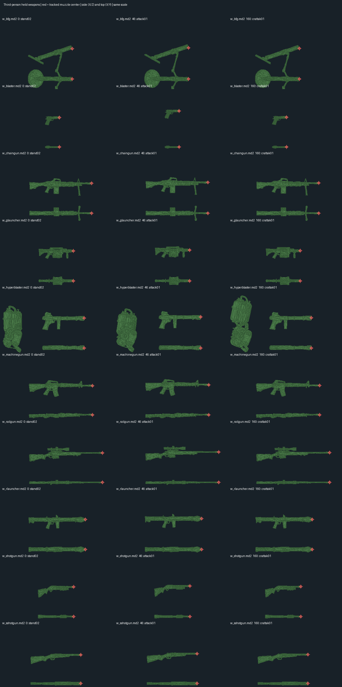

# Third-person player muzzle attachments

The November 8 screenshot showed a rifle flash floating above its barrel in the
other split-screen view. All bundled player firearms shared the same estimated
placement logic, so this was not a single rifle tuning value.

The old code added 25 units in world Z before applying per-weapon offsets. A
level rifle consequently flashed around local Z34, while its barrel is near
Z16. That fixed world-height correction also failed to rotate with the model
when aiming. Crouching was approximated with another fixed offset, animation
movement was ignored, and an additional lag correction was subtracted from an
already-interpolated origin. The short-lived sprite then drifted using scaled
velocity instead of remaining attached to the gun.

## Implemented behavior

`CL_GetThirdPersonMuzzle` resolves the same linked player weapon the renderer
uses. It interpolates a model-space barrel point between the actual MD2 frames,
then applies the rendered player origin and orientation. This includes crouch
transitions, firing recoil, angle wrap, pitch and roll. The roll sign follows
the alias renderer's `Rz(yaw) * Ry(pitch) * Rx(-roll)` matrix. Disabling model
interpolation also disables interpolation of the attachment's animation point.

Every third-person sprite submission resolves the endpoint against that view's
entity history. Only a local rendering copy changes, keeping shared effects
independent of split-screen view order. Expired, missing, or weapon-switched
shooters cannot leave an attached flash behind. Third-person dynamic lights
start at the barrel; their short-lived light state retains the existing lifetime
behavior. First-person, ADS, flash artwork, sizes, durations, and weapon firing
or projectile behavior are unchanged.

For the bundled soldier weapons, model attachment supplies position; historic
third-person forward/right/up, world-height, crouch-height, velocity and lag
compensation values do not move the attachment. Style settings still apply.
The legacy offset tuning remains a fallback for optional custom weapon models
without authored attachment data. Its height is now model-local and it no
longer subtracts an extra interpolation lag. The old lag cvars are retained for
configuration compatibility but no longer affect placement.

## Covered assets

Ten firearm meshes and the generic `weapon.md2` fallback have reviewed barrel
markers through all 198 player animation frames:

| Player weapon | Held model |
| --- | --- |
| Pistol | w_blaster.md2 |
| Rifle / M16, ETF event alias | w_machinegun.md2 |
| Heavy machine gun / M60 | w_chaingun.md2 |
| Shotgun | w_shotgun.md2 |
| Double-barrel shotgun | w_sshotgun.md2 |
| Grenade launcher | w_glauncher.md2 |
| Rocket launcher / bazooka | w_rlauncher.md2 |
| M1 flamethrower | w_hyperblaster.md2 |
| Sniper rifle | w_railgun.md2 |
| Mortar cannon | w_bfg.md2 |
| Generic held-weapon fallback | weapon.md2 |

The double-barrel marker is centered between its paired openings. The mortar
marker follows its elevated tube. Thrown grenades/mines and other throwables do
not emit firearm muzzle events. The standalone SMG tuning name does not identify
a separate equipped firearm item in this build; its event alias is tested.

The source-vertex selections and MD2 hashes are pinned in
`tools/assets/build_player_muzzle_points.py`. The generated client header is
`src/client/header/player_muzzle_points.h`; the audit report is
`tools/assets/player-muzzle-points.json`. No model geometry was modified.



After intentional model edits, review the barrel-rim vertex selection and update
its source hash, regenerate the header/report, and rebuild the client. The
source-hash checks deliberately reject silently using markers from a different
mesh. The runtime table describes the bundled models; custom replacements need
their own reviewed attachment data.

## Verification

```sh
python3 tools/assets/build_player_muzzle_points.py --check
python3 tests/assets/test_player_muzzle_points.py
sh tests/performance/run_effects_tests.sh
make -j2 client
```

The four asset checks independently decode every shipped MD2 frame, verify
archive provenance and inventory coverage, and check reproducibility and changed
source rejection. Production effect tests pass normally and under ASan/UBSan.
They include 13,068 model/frame/rotation/interpolation comparisons against an
independent renderer matrix and all 14 supported muzzle-event variants, plus
moving/crouching shooters, differing observer histories, reverse submission
order, fallback/retry, expiry, removal and weapon changes. Existing first-person
and shared-effects regressions remain passing.

`tools/performance/capture_player_muzzles.py` captures real shots using the
existing third-person review camera. It copies the executable beside isolated
data and never uses the playing configuration. It temporarily extends only
third-person flash duration to make screenshots practical; the shipped 50 ms
durations stay unchanged. Captures and manifests live under `build/muzzle-qa/`.
These are visual alignment checks, not a complete combat playthrough.

### In-game review

Valid X11 captures are retained under `build/muzzle-qa/`: the 40-view
`fixed-all-x11` set covers ten weapons at level/up/down/crouched poses; some
50 ms flashes were missed by screenshot timing, so it is not counted as 40
visible-flash confirmations. `fixed-all-level-confirmed` uses a private client
profile with 1500 ms flash lifetime to make single-shot effects reviewable.
Only the copied archive is changed; the playing profile retains its original
SHA256 `219e0f1ec97fa6b944336f263726564a3eb0a176351f5fd19f805913d24a22ea`.

`fixed-split-rifle/screenshots/rifle-down.png` captures two actual local clients:
the top shooter retains its first-person flash, and the bottom observer sees
the third-person flash at the downward-pointing rifle barrel. These runtime
checks complement the all-frame geometry and per-observer production tests.
Early Wayland/offscreen capture attempts produced black screenshots or driver
initialization failures and are excluded from visual validation.

All ten firearms have visually verified, visible flashes at their barrel ends.
Pistol/sniper shots were re-captured after their windup in
`fixed-pistol-sniper-confirmed`. The combined review sheet is
`build/muzzle-qa/all-weapons-confirmed.png`; exact screenshot hashes and review
limits are recorded in `build/muzzle-qa/visual-validation.json`.
The verified client matches the installed `release/quake2` SHA256
`4480681fc89d79fb10a6fe1707f503bed46082d9f97c88839c03c3f0d5913302`.
