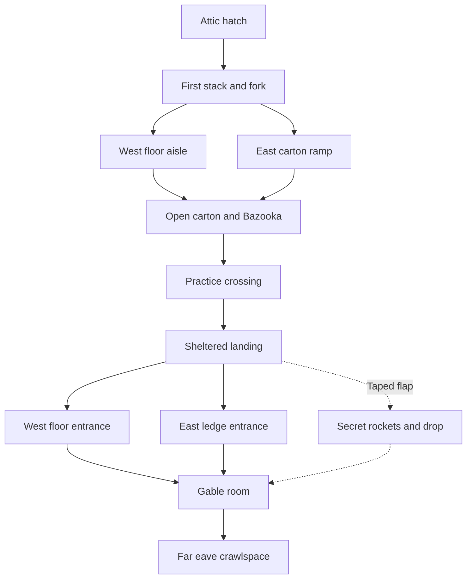

# Attic level design and blockout plan

- **Working map name** `pp_attic`
- **New campaign weapon** Bazooka (`weapon_rocketlauncher`)
- **First pass** Routes, structural box stacks, encounter placement, one weapon cache, one optional shortcut, and the exit. Reserve prop dressing and the detailed pickup pass for later.

The squad climbs through an attic hatch and crosses a storage area at floorboard height. Oversized cartons form the walls, and their gaps and open flaps explain where a tiny soldier can go. Two routes through the first stacks meet at the Bazooka cache. The player tries the weapon from a safe distance, then decides whether to fight across the last room with rockets or get around the defenders through the boxes. Assume players arrive with at least the pistol and shotgun and already know how to use cover and explosive barrels. The exact campaign slot and next map are open. [Garden Infiltration design guide](garden-infiltration-level-design.md)

## Attic setting

Set worldspawn `sky` to `pp_attic`. The upstream skybox is a floor-level attic with rafters, floorboards, a boarded gable window, and a hanging bulb. Use sky faces on the sealed shell to reveal the distant room and overhead scale. Give the playable space its own solid floor, carton walls, ramps, and openings. Place broad views of the backdrop at the hatch and near the far gable. Orient the map in a walk-through so the gable and warm light help the player read the overall direction. Use real box silhouettes and local lighting to mark the actual turns and exit. [Upstream skybox commit](https://github.com/suntank/plasticPlatoon/commit/50a5074329b50621fcc265beb8343908a296002d) · [Attic skybox scene](https://github.com/suntank/plasticPlatoon/blob/50a5074329b50621fcc265beb8343908a296002d/tools/assets/render_attic_skybox.py)

## Route and encounter blockout

The expanded blockout spans about **4,900 × 7,250 Quake units**, with north toward the far gable and the main floor at `z = 0`. The old gable room's **1,920 × 496-unit** footprint is the minimum floor-area reference for combat. The new fork, storage rooms, and practice crossing each exceed that area. The new gable room is **2,816 × 832 units**. The intervening passages are mostly **160 units wide**, with **192 units** at the raised finale approach. The east route rises to `z = +96` and ramps back to floor level before the cache. Coordinates below are landmarks in the playable blockout.

| Area and seed position | Layout and first-pass encounter |
| --- | --- |
| **A. Hatch** `(0, -3264)` | Four starts on a quiet landing with a view of the roof. The first hostile sightline is beyond the offset exit passage. |
| **B. First stack** `(0, -2112)` | Four pistol soldiers and one shotgun ambusher spread across the first fight. Low cover gives the player places to pause before the full-height stack splits the route. |
| **C. West floor aisle** `(-1760, -944)` | Five pistol soldiers occupy the entrance and deeper positions around a loop through the stacks. A structural return breaks the direct line to the cache and screens a shotgun defender on the far side. |
| **D. East carton ramp** `(1760, -944)` | A carton lid ramps up to a broad deck. Five pistol soldiers occupy the deck, floor, and rear lane. A shotgun soldier covers the bend toward the cache. A raised sightline and a route around the far end of the divider draw the fight deeper into the room. |
| **E. Open carton cache** `(0, 100)` | Both branches enter the same quiet room through offset openings. The launcher sits inside an oversized open carton lit from the front. A health pickup gives the player a chance to recover before the practice fight. |
| **F. Practice crossing** `(0, 1104)` | A box return screens the first three light soldiers from the approach passage. Once around it, the player gets a rocket sightline about **300 units** long. Two pistol soldiers and a shotgun defender wait deeper, beyond the first blast. |
| **G. Sheltered landing** `(0, 1936)` | A box elbow breaks contact after practice. The landing holds one health pickup and the first rocket refill. Separate passages lead to the west floor entrance and the east ledge. The secret starts here. |
| **H. Gable room** `(0, 2816)` | The floor and raised entrances meet in a room with several lanes around tall cartons. Eight pistol soldiers, three close shotgun defenders, and one rear machine gunner spread the fight across the entrances, middle stacks, and far side. A pistol soldier meets the east approach on the ledge, with another below the descent. Returns in both outer lanes turn players toward the interior before they reach the eave passages. |
| **I. Far eave crawlspace** `(0, 3792)` | Two passages from the gable room meet at an eave chamber. The low framed opening beyond it ends the blockout and leaves room for the eventual transition. |

The blockout places 35 enemies across the map. Each first-route branch holds six, and the finale holds twelve. Cover and enemy placement separate first contact from the defenders farther in.

## Bazooka lesson, finale, and secret

The launcher pickup granted five rockets in the portable playtest. The sheltered landing has one two-rocket `ammo_rockets` refill (`count` set to `2`). This lets players spend their starter ammo learning and still enter the finale with a couple of shots. Check the weapon handoff and effective ammo per player in co-op. The player Bazooka has contact detonation and a default 120-unit damage radius. Test muzzle clearance and actual splash at the firing positions, especially on the ledge, beside box lips, and when a teammate steps across the lane. [Bazooka weapon tuning](../src/game/player/pp_weapon_tuning.c#L356) · [Ammo quantity override](../src/game/g_items.c#L760) · [Default rocket ammo](../src/game/g_items.c#L2179)

The practice room gives the player an obvious group and a safe first sightline. In the finale, the **west floor entrance** favors cover-to-cover movement and close fights behind the island. The **east ledge** offers a view of the foot of the machine gunner's stack and the enemies crossing beneath it, then ramps back to the floor behind a tall carton. Bursts from the high defender should interrupt exposure in both lanes while leaving a full-cover fallback at each entry. The room should remain beatable after spending every rocket in practice or walking past the cache. Reserve the rockets for tactically useful groups and hard-to-reach positions.

At the sheltered landing, a climb onto a tipped lid reveals a taped, damaged carton flap. Make the flap shootable with an ordinary gun. Behind it, place two bonus rockets and a short one-way drop into protected side cover in the finale. The reward saves one exposed crossing and gives a new angle on the room. Put a fixed box return immediately behind the flap and dogleg the drop so opening it preserves the practice room's sightline break. Check landing clearance in co-op, including when another player is already at the bottom.

## VIS and runtime budget

- **Use the boxes as architecture.** Make the sealing shell and major carton masses simple structural world brushes. Block the bending connections with staggered stacks and roof-height returns or solid headers where a route could otherwise see across the map. Reserve tape, seams, flap edges, thin slats, and silhouettes that provide no useful occlusion for the detail pass.
- **Check the worst viewing heights.** Aim for each main position to show its current fight and a small part of a neighboring approach. Test from the fork, east ramp crest, cache exits, practice firing position, both finale entrances, and the secret with its flap open. Aim to keep the two first-route fights screened from each other and the earlier rooms outside the finale's PVS. Confirm with compiled VIS data and runtime views. The skybox provides the room backdrop, and fixed geometry bounds what can be seen of the playable map.
- **Measure the greybox with real fights.** Run a leak-free BSP and full VIS, and record cluster visibility and per-view world and entity submission from those positions. Profile target hardware in solo and four-player split-screen. Include the team together in the finale and split across the two branches, plus a separated late-map case with concurrent combat and actual rocket effects. Record average FPS and P95 frame time using matching settings. The earlier Garden run is a workload reference at **32.50 average FPS and 35.92 ms P95** on Hard with four players. Treat that as a comparison for headroom before adding detail. [Map compiler](../tools/performance/compile_map.py) · [Garden Pi combat profile](../doc/performance/pi-profile-20261116.md)

## Before the detail pass

1. Walk both routes from the hatch to the cache and both regular approaches from the landing to the exit. Check path widths, ramp clearance, enemy traversal, co-op passing, and ways out of each exposed lane.
2. Watch a first-time player read the first split, find the launcher from either branch, and recognize the first safe rocket shot through the geometry and lighting. Check the finale with and without rockets. Check that the shortcut is useful, optional, and lands in cover.
3. Review compiled VIS and the heaviest measured views. Fix cross-room exposure at raised positions and across the opened secret first. Use the resulting layout and performance captures as the baseline for the later prop and pickup pass.

## Attic dressing

The hatch opens under exposed trusses beside a covered chair and a steamer trunk. The west storage route has an open trunk, suitcase, and file box. The east storage route has a giant teddy bear and toy rocket. The Bazooka carton shares its landing with an old clock, leaning frames, and folded blankets. A camera overlooks the practice room, a gramophone waits on the sheltered landing, and a toy drum and packing cartons mark the finale. Floorboards, packing tape, and paper labels reinforce scale along the walk.

The 31 placements use the supplied TrenchBroom prefabs. The dressing lives in named editor groups and compiles into local static brush models so the renderer can cull individual props. The original map brushes retain their geometry, and the encounter, pickup, secret, and exit entities retain their placements. The art pass changes surface materials, adds dressing models, and uses baked accent lights.

Full VIS produced the same visibility data as the tuned blockout. The BSP still has 228 clusters, 412 portals, and 31 average potentially visible clusters. In eleven matched desktop views, peak submitted BSP triangles rose from 496 to 1,496. The final selection brought that peak down from 1,792 in the first measured detail pass. Split-screen frame time still needs a target-device run.

## Playable build

Run `map pp_attic` from the console. The editable map is [`pp_attic.map`](source/pp_attic.map). The portable build loads [`operation-attic.pk3`](../baseq2/operation-attic.pk3), which contains the BSP, six `pp_attic` sky faces, and the map's materials. The far eave fires an in-level goal while the campaign destination is pending.

Each room and connecting passage has named TrenchBroom groups for its walls and floor and for its ceiling. The thin shells leave unbuilt space between the rooms, outside the playable seal. Hide the ceiling groups to work from above. The narrow turns and major dividers stay structural. Small cover is collision-solid detail, and the separately grouped VIS hint planes split the passage mouths.

The tuned full VIS build reports 412 portals and 31 average potentially visible clusters, compared with 389 and 30 before encounter tuning. The two storage routes stay outside each other's sampled PVS, and neither sampled finale entrance includes the opening rooms. Split-screen frame time still needs a target-device run.

Recompile with `python3 tools/performance/compile_map.py --map pp_attic --tool /path/to/q2tool --rad-subdiv 128 --rad-ambient 42`. The default release profile runs BSP, full VIS, and RAD. Refresh the MAP and BSP in the mission archive when staging later edits for the portable build.
